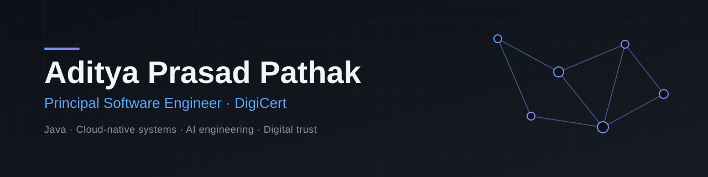

<!--
  No required placeholders remain; optional TODO comments below are invisible when rendered.
  Search for "<" and "TODO" before publishing.
-->

 

**Systems that stay correct under load and trustworthy under scrutiny.**

13+ years building enterprise-scale backend platforms in Java, now applying the same engineering discipline to cloud-native infrastructure and practical AI integration.

---

## About

I'm a Principal Software Engineer at **DigiCert** with 13+ years in software engineering, focused on enterprise-grade backend systems: Java, Spring Boot and microservices that have to be scalable, observable and boring in production.

My work sits at the intersection of four areas:

- **Distributed systems:** service design, messaging, caching and failure-aware architecture.
- **Cloud-native engineering:** containerised workloads on Kubernetes, with infrastructure defined as code.
- **Applied AI:** integrating LLMs into Java applications in a way that is testable and maintainable.
- **Digital trust:** PKI, certificates, cryptography and software supply chain security.

I care about clean architecture, clear failure modes and code the next engineer can reason about.

---

## Technical Expertise

| Area | Technologies |
| :-- | :-- |
| **Languages** | Java (primary) <!-- TODO: add other languages you use professionally, e.g. SQL, Python, Bash --> |
| **Backend** | Spring Boot · Spring Framework · J2EE · Spring Security (JWT) · Spring Data JPA · REST / OpenAPI · Microservices |
| **Cloud** | AWS <!-- TODO: list only the AWS services you actually use --> |
| **DevOps** | Docker · Kubernetes · Helm · AWS CDK · Maven · Gradle |
| **Messaging & Storage** | Apache Kafka · MySQL · PostgreSQL · Redis |
| **AI Engineering** | Spring AI · LangChain4j · RAG · Vector databases (Qdrant) · Ollama · Gemini |
| **Security** | PKI · Digital certificates · Cryptography · Certificate lifecycle management |
| **Architecture** | Distributed systems · System design (HLD/LLD) · Scalability · Reliability · Multi-tenancy |

---

## Featured Projects

<table>
  <tr>
    <td colspan="2" valign="top">
      <h3><a href="https://github.com/adityaprasadpathak/skill-lens">SkillLens</a></h3>
      
<b>Problem:</b> Authoring, grading and analysing technical assessments is manual work. SkillLens uses a local LLM to generate questions and adds multi-tenant organisation, role and analytics management around it.

      
<b>Stack:</b> Java 17 · Spring Boot · Spring Security + JWT · Spring Data JPA · PostgreSQL · Ollama · OpenAPI/Swagger

      
<b>Architecture highlights:</b>

      <ul>
        <li>Stateless JWT authentication with method-level RBAC (<code>SUPER_ADMIN</code>, <code>ORG_ADMIN</code>, <code>INSTRUCTOR</code>, <code>STUDENT</code>).</li>
        <li>Tenant isolation by filtering queries on organisation ID.</li>
        <li>Ollama question generation in sync and async modes, with batch generation offloaded to background threads.</li>
        <li>JPA Specifications for filtering and pagination pushed down to the database.</li>
      </ul>
      
<b>Why it's interesting:</b> It combines LLM integration with the unglamorous parts of enterprise software: tenancy boundaries, authorisation, soft deletes and attempt tracking (including tab-switch events during an exam).

      
Status: <b>In progress.</b> Core platform and Ollama integration are built; email invitations, PDF reports and a web frontend are still on the roadmap.

    </td>
  </tr>
  <tr>
    <td colspan="2" valign="top">
      <h3><a href="https://github.com/adityaprasadpathak/auction">auction</a></h3>
      
<b>Problem:</b> A sample auction application built on Spring Boot.

      
<b>Stack:</b> Java · Spring Boot · Maven

      <!-- TODO: add one line on the bidding / concurrency design once you've decided what to highlight, or remove this card -->
      
Status: <b>Sample project.</b>

    </td>
  </tr>
</table>

---

## AI & Engineering Lab

Hands-on exploration of applied AI in Java. Status is labelled so shipped work isn't confused with experiments.

| Topic | Focus | Status |
| :-- | :-- | :-- |
| **LLM apps in Java** | Local model integration via Ollama, sync and async generation | Implemented in [SkillLens](https://github.com/adityaprasadpathak/skill-lens) |
| **RAG architectures** | Ingestion, chunking, retrieval and grounded generation with Spring AI / LangChain4j | Exploring |
| **Semantic search** | Embeddings and vector search with Qdrant | Exploring |
| **AI-assisted engineering** | Developer-productivity workflows | Exploring |
| **Security-focused systems** | JWT/RBAC and tenant isolation in SkillLens; certificate lifecycle and supply chain security as areas of study | Mixed |

<!-- TODO: when a public RAG or vector-search repo exists, link it here and change its status. -->

---

## Languages

<picture>
  <source media="(prefers-color-scheme: dark)" srcset="https://github-readme-stats.vercel.app/api/top-langs/?username=adityaprasadpathak&layout=compact&hide_border=true&theme=tokyonight&langs_count=6">
  <source media="(prefers-color-scheme: light)" srcset="https://github-readme-stats.vercel.app/api/top-langs/?username=adityaprasadpathak&layout=compact&hide_border=true&theme=default&langs_count=6">
  
</picture>

<!--
  FALLBACK: the public github-readme-stats instance is occasionally rate-limited.
  If the card shows an error, delete this section; nothing else depends on it.
-->

---

## Currently Exploring

- Java-based AI engineering: RAG pipelines, vector search and evaluation
- Advanced cloud-native architectures on AWS and Kubernetes
- Distributed systems design trade-offs
- Post-quantum cryptography and its impact on PKI

---

## Contact & Collaboration

I'm open to conversations about enterprise architecture, cloud-native design, applied AI in Java and digital trust engineering.

- GitHub: [adityaprasadpathak](https://github.com/adityaprasadpathak)
- LinkedIn: https://www.linkedin.com/in/aditya-pathak-74a17857
- Email: adityaprasadpathak@hotmail.com
